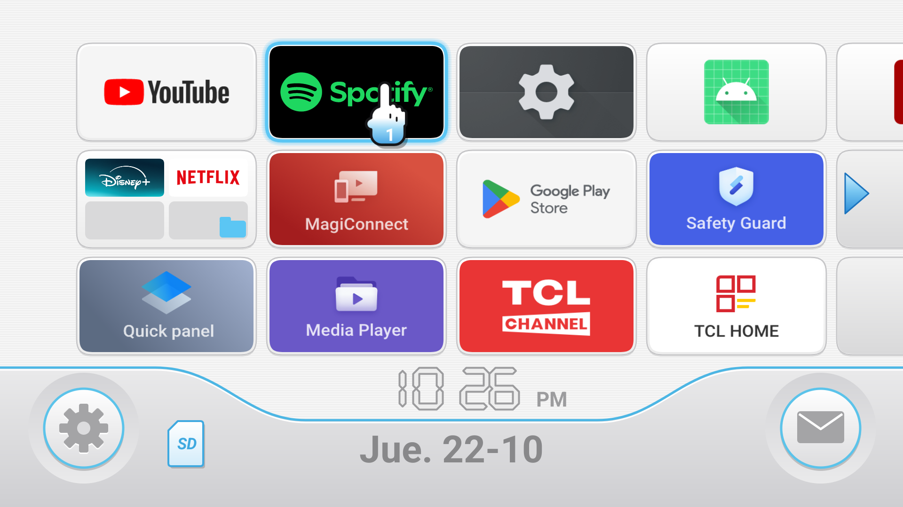
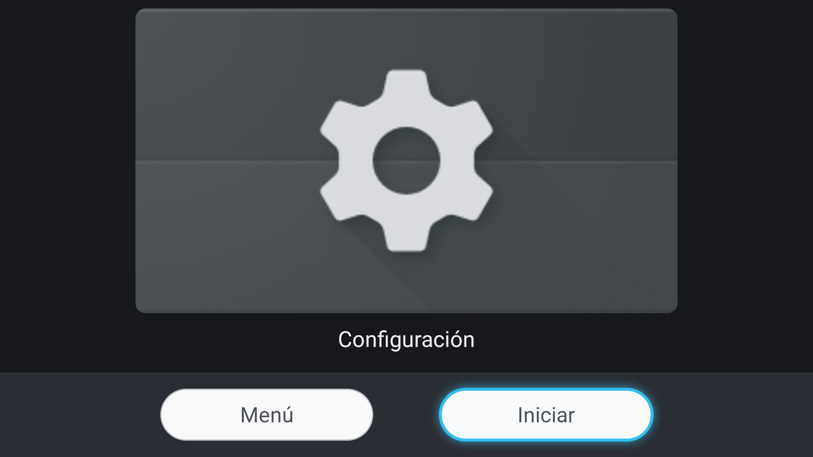

# Wii Launcher TV

A light, Wii-inspired home screen for Android TV and Google TV. No ads, no recommendations, no tracking. The APK is about **55 KB**, has **zero dependencies**, and draws its whole menu on one canvas.

> Un launcher liviano para Android TV / Google TV con el estilo del menú de Wii. Sin anuncios, sin recomendaciones, sin rastreo. [Versión en español abajo](#español).



| Channel preview | |
|---|---|
|  | Press **OK** on a channel to zoom in, then pick **Start** or **Menu**, like on the Wii. |

> Not affiliated with Nintendo. No Nintendo assets are used. See [DISCLAIMER.md](DISCLAIMER.md).

## Features

- **Channel grid**: 4×3 channels per page. TV banners fill the tile; phone apps show their icon on a white channel face. A blue glow pulses on the focused channel, a name bubble shows below it, and the page flips when you cross the grid edge.
- **Channel preview**: zoom animation with **Menu / Start** buttons.
- **Bottom bar**: clock, date and page dots. The ⚙ button opens system settings. The ✉ button blinks blue when a new version is published.
- **Sounds**: synthesized at runtime, no audio files.
- **Reordering**: press the Menu key or long-press OK on a channel, then choose *Move left / right* or *App info*.
- **Self-updating**: checks this repository's [Releases](https://github.com/CpuJP/WiiLauncherTv/releases) and installs through the system installer, so the TV asks you to confirm.
- **Sharp at any resolution**: everything is laid out in a virtual 1920×1080 space and scaled to the real surface. Shapes and text are drawn as vectors and banners are decoded at the final pixel size, so a 4K surface renders natively at 4K.
- **Light on the device**: one Activity and one View, plain Java without AndroidX. Animations stop when the menu is not visible, and at most 24 banners are cached.
- **Keeps your TV's functions**: every installed app is listed, including Live TV and the vendor apps. Search and mic open the assistant, and Settings is one press away.

## Install

1. On the TV, enable **Developer options** and **USB debugging** (see [docs/CHEATSHEET.md](docs/CHEATSHEET.md)).
2. Download the latest `WiiLauncherTv-x.y.z.apk` from [Releases](https://github.com/CpuJP/WiiLauncherTv/releases) and check it against `SHA256SUMS.txt`.
3. Install the APK and make it the Home screen:

```bash
export TV=192.168.1.50:5555          # your TV's IP
adb connect $TV
adb -s $TV install -r WiiLauncherTv-*.apk
tools/setup-tv.sh                    # home + Home-key routing + updater permission
```

To get the stock home back, run `tools/restore-home.sh`.

### Why an accessibility service?

Google TV's launcher has a higher system priority than any user-selected home, so it still opens when you press **Home**. `HomeKeyService` intercepts the Home key and opens this launcher. It also replaces the stock home whenever that home appears anyway, for example at boot or on Back out of an app. It cannot read the screen and stores nothing.

Android turns accessibility services off when their app is force-stopped. `tools/setup-tv.sh` therefore grants `WRITE_SECURE_SETTINGS` over ADB, and the launcher uses it to turn its own service back on. See [SECURITY.md](SECURITY.md).

## Build

Requires JDK 21 and the Android SDK (platform 34).

```bash
./gradlew test lintRelease assembleRelease   # app/build/outputs/apk/release/app-release.apk
tools/deploy.sh                              # build + install + open on $TV
```

## Release

```bash
tools/release.sh 1.1.0
```

This command bumps `VERSION_NAME`, commits, tags `v1.1.0` and pushes. [GitHub Actions](.github/workflows/release.yml) then tests, builds and publishes the APK with its SHA-256. Installed launchers see the update within 6 hours, and the ✉ button starts blinking.

## Project layout

```
app/src/main/java/io/github/cpujp/wiilauncher/
  MainActivity.java     HOME activity, routes actions to the system
  WiiMenuView.java      the whole UI: grid, preview, bottom bar, input
  Grid.java             page and focus navigation (unit tested)
  AppRepository.java    launchable apps and saved order
  AppOrder.java         order merge and move logic (unit tested)
  Updater.java          GitHub Releases check and install
  ReleaseInfo.java      release JSON parsing (unit tested)
  Versions.java         version comparison (unit tested)
  HomeKeyService.java   Home key routing on Google TV
  Sfx.java              synthesized sounds
tools/                  ADB helpers: monitor, debloat, deploy, release, YouTube
```

## License

[MIT](LICENSE) © 2026 Juan Pablo Giraldo Collazos. Third-party app names and logos belong to their owners.

---

## Español

**Wii Launcher TV** reemplaza la pantalla de inicio de tu Android TV / Google TV con un menú inspirado en el de Wii:

- Canales en grilla de 4×3.
- Vista previa con **Menú / Iniciar**.
- Reloj y fecha.
- Botón ⚙ de ajustes.
- Botón ✉ que parpadea cuando hay una versión nueva.

No muestra anuncios, no tiene dependencias y pesa unos 55 KB.

**Instalación rápida:** descarga el APK de [Releases](https://github.com/CpuJP/WiiLauncherTv/releases). Después instálalo con `adb install` y ejecuta `tools/setup-tv.sh`. Para volver al inicio original, ejecuta `tools/restore-home.sh`.

**Control:**

| Botón | Acción |
|---|---|
| Flechas | Moverse entre canales. En el borde cambia de página. |
| OK | Abrir la vista previa. Después elige **Iniciar**. |
| Mantener OK o tecla Menú | Mover el canal o ver la información de la app. |
| Abajo desde la última fila | Ir a los botones ⚙ y ✉. |
| Atrás | Volver a la primera página. |
| Inicio | Volver al menú desde cualquier app. |

Comandos de ADB, limpieza y deshacer: [docs/CHEATSHEET.md](docs/CHEATSHEET.md).
